# 한눈에 보는 highfive 클라이언트

지금 저장소에 만들어진 것을 그림으로 설명한다. 규칙의 근거와 세부는 각 절 끝의 문서를 본다.
그림은 Mermaid라서 GitHub, VS Code(Markdown Preview Mermaid Support 확장), Obsidian에서 그대로 보인다.

## 1. 저장소 지도

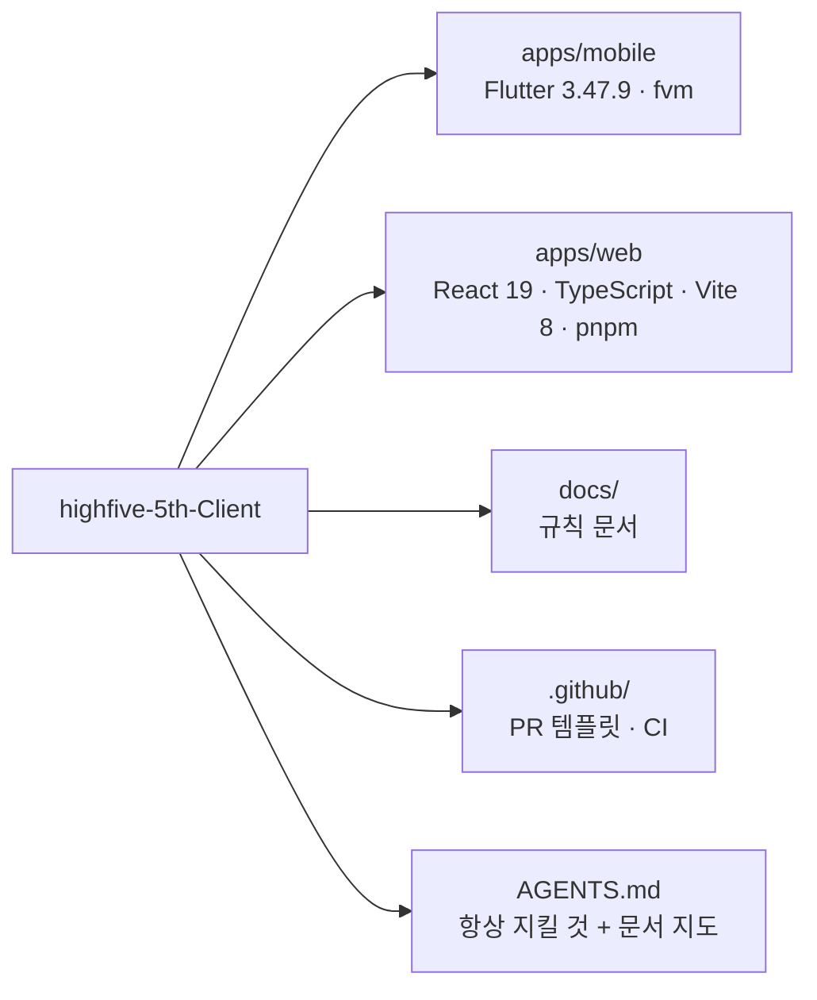

| 폴더 | 들어 있는 것 | 명령 실행 위치 |
| --- | --- | --- |
| `apps/mobile` | Flutter 앱. 로그인·공연·신청·채팅·티켓·QR | `cd apps/mobile && fvm flutter ...` |
| `apps/web` | 공개 웹(이벤트·공지·FAQ) + 관객용 모바일 웹(예정) | `cd apps/web && pnpm ...` |
| `docs` | 작업 흐름, 앱·웹 구조, 디자인 토큰, PR 체크리스트 | - |
| `.github` | PR 템플릿, CI(`workflows/mobile.yml`·`web.yml`: PR마다 앱·웹 검증) | - |

## 2. 전체 그림: 누가 누구와 통신하나

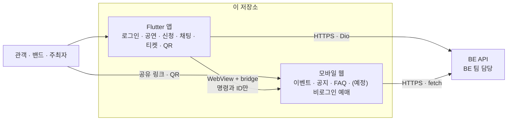

- 앱과 웹은 서로 데이터를 직접 주고받지 않는다. 웹은 "이 공연으로 이동해" 같은 **명령과 ID만** bridge로 앱에 보내고, 앱이 라우팅한다.
- 권한·재고·가격·마감은 항상 BE가 판단한다. 앱·웹은 받은 결과를 보여주기만 한다.
- 앱 세션 토큰은 웹 URL에 절대 넣지 않는다.

## 3. 앱 구조

### 3-1. 폴더와 역할

```
lib/
├── main.dart          앱 시작: 환경 결정 → DI 등록 → 화면
├── app/               앱 전체를 묶는 것. app.dart · di.dart · env.dart · providers.dart · router.dart
├── core/              기술 기반 (통신·저장·DI 컨테이너). 공연·예매 같은 단어를 모른다
├── shared/            공통 UI (디자인 토큰·공통 위젯). 역시 도메인을 모른다
└── features/<기능>/   한 기능의 모델·데이터·화면이 전부 여기
    ├── models/        도메인 모델 (freezed)
    ├── data/          dto · services · repositories
    └── presentation/  providers · view_models · views · widgets
```

지금 있는 기능은 `auth`(로그인 화면 자리)뿐이다. 나머지 8개(`bands` `performances` `recruitments` `venues` `ticketing` `payments` `settlements` `chat`)는 실제로 만들 때 생긴다.

### 3-2. import 방향 — 화살표 방향으로만 갈 수 있다

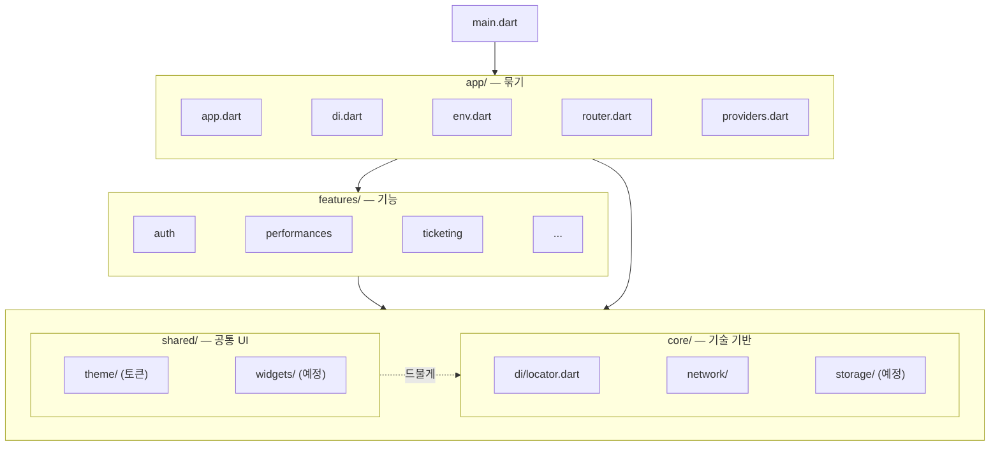

| 할 수 있다 | 할 수 없다 |
| --- | --- |
| `app` → 모든 곳 | `features` → `app` (순환이 생기고, 기능이 앱 설정에 기대게 됨) |
| `features` → 같은 기능 안, `core`, `shared` | `features/A` → `features/B`의 `presentation/` (화면·ViewModel·위젯) |
| `features/A` → `features/B`의 `data/repositories`, `models` (명시적 계약) | `core` → 어디든 (core는 맨 아래) |
| `shared` → 드물게 `core` | `shared` → `features`, `app` |

왜 이렇게 하나: **아래층이 위층을 모르면 아래층만 따로 테스트하고 바꿀 수 있다.** `getIt`을 `core/di/locator.dart`에 둔 이유도 features가 `app`을 import하지 않고 연결 Provider를 만들게 하려는 것이다.

### 3-3. 기능 하나의 안쪽

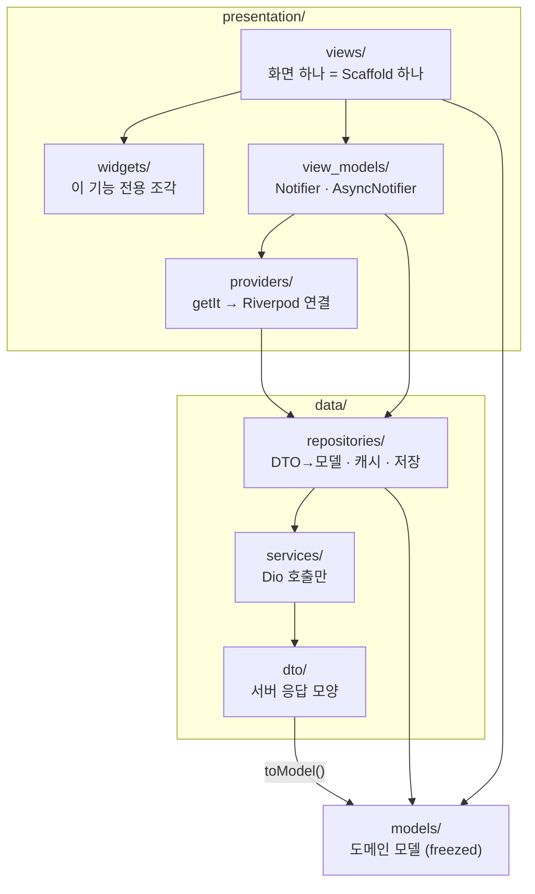

| 층 | 한다 | 하지 않는다 |
| --- | --- | --- |
| View | 표시, 입력, 화면 이동, ViewModel 메서드 호출 | HTTP 호출, 비즈니스 판단 |
| ViewModel | 상태 보유, 사용자 명령, 중복 실행 방지 | 위젯·BuildContext 사용, getIt 조회 |
| Repository | DTO→모델, 메모리 캐시, 저장소 읽기·쓰기 | 위젯·Riverpod 의존 |
| Service | Dio·SDK 호출, DTO 반환 | 모델 변환, 캐시 |

### 3-4. 데이터가 흐르는 순서 — 공연 상세를 열 때

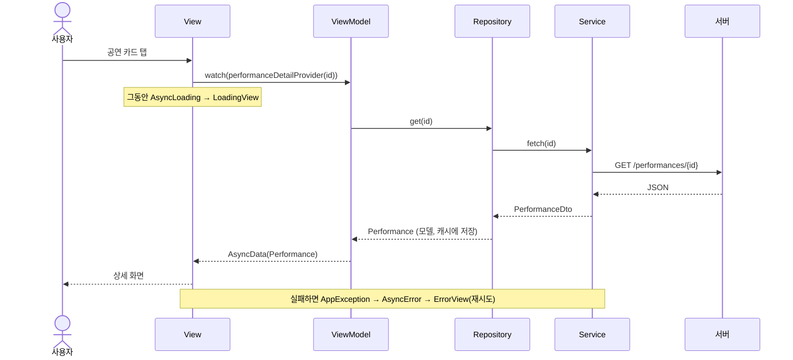

### 3-5. 쓰기 명령 — 두 번 눌러도 한 번만 간다

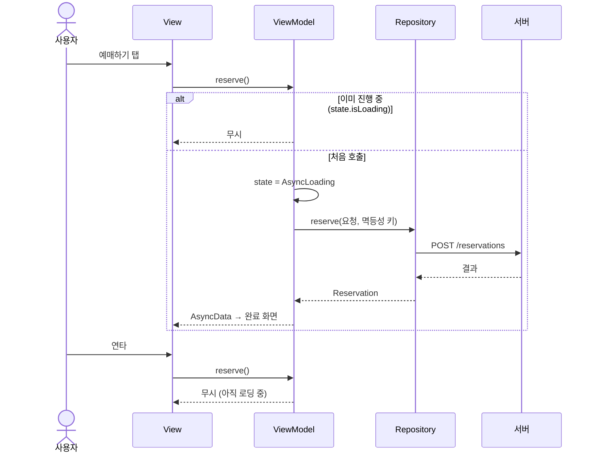

- 쓰기 명령은 Provider가 만들어질 때(`build()`)가 아니라 **버튼 → ViewModel 메서드**로만 실행한다.
- 타임아웃은 실패 확정이 아니다. 같은 멱등성 키로 결과를 먼저 조회한다.

### 3-6. 앱이 켜질 때

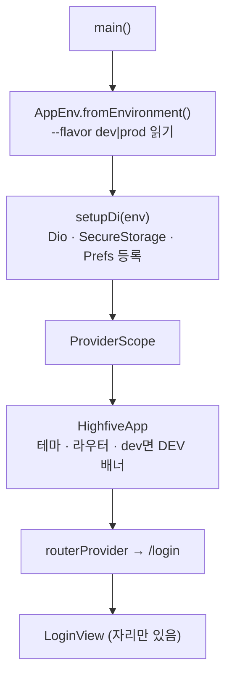

### 3-7. 상태는 어디에 두나

| 이런 상태는 | 여기에 | 예 |
| --- | --- | --- |
| 입력 중인 값 | 위젯 로컬 | 로그인 폼, 검색어 |
| 화면 하나의 비동기 결과 | `AsyncNotifier` (autoDispose) | 공연 상세 로딩·실패 |
| ID마다 다른 것 | `.family` | 공연 ID별 상세 |
| 앱 어디서나 | keepAlive Provider | 로그인 세션 |
| 서버에서 받은 데이터 캐시 | Repository 메모리 | 공연 목록 |
| 앱을 껐다 켜도 남아야 하는 것 | 인증은 SecureStorage, 설정은 Prefs | 토큰, 마지막 본 탭 |

자세히: [mobile-architecture.md](./mobile-architecture.md)

## 4. 웹 구조

### 4-1. import 방향

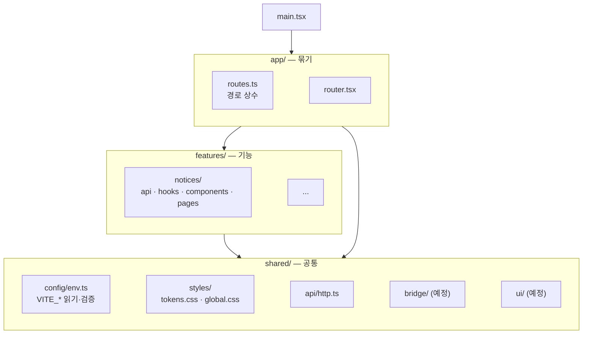

앱과 같은 원칙이다. 차이는 `features`가 `app/routes.ts` 하나만 import할 수 있다는 것(링크를 만들려면 경로 상수가 필요한데, `routes.ts`는 아무것도 import하지 않아 순환이 없다).

### 4-2. 지금 라우트와 환경

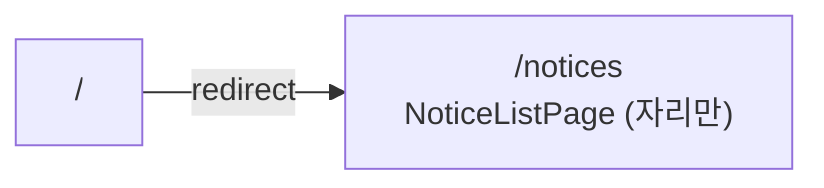

| 파일 | 값 | 쓰이는 때 |
| --- | --- | --- |
| `.env` | `VITE_FLAVOR=dev`, dev API 주소 | `pnpm dev`, `pnpm build:dev` |
| `.env.production` | `VITE_FLAVOR=prod`, prod API 주소 | `pnpm build` |

`VITE_*`는 번들에 그대로 들어가므로 비밀값을 넣지 않는다. 환경값은 `shared/config/env.ts`로만 읽고, 잘못된 값은 빌드 때(`vite.config.ts`)와 시작 때 두 번 걸린다.

자세히: [web-architecture.md](./web-architecture.md)

## 5. 디자인 토큰이 흐르는 길

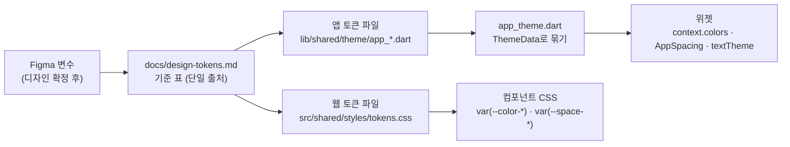

두 단계로 나눈 이유:

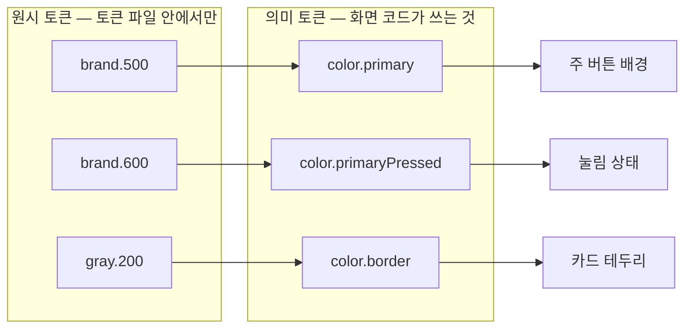

디자인이 바뀌면 **의미 토큰이 가리키는 원시 값만** 바꾼다. 화면 코드는 그대로다. 앱·웹 파일과 문서는 항상 한 PR에서 같이 바뀐다.

자세히: [design-tokens.md](./design-tokens.md)

## 6. 일하는 순서

### 6-1. 브랜치

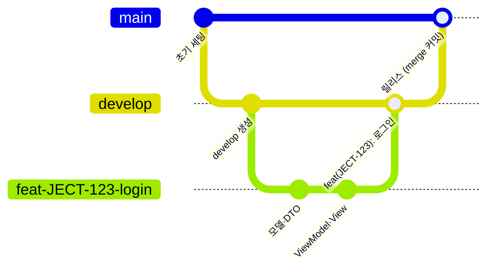

- 기능 브랜치 → `develop`은 squash(커밋 제목은 `feat(JECT-123): 요약` 규칙으로 고친다), `develop` → `main`은 이력을 남기는 merge.
- `develop`은 아직 없다. 첫 기능 작업 전에 만든다.

### 6-2. 기능 하나를 만드는 순서 — 아래층부터

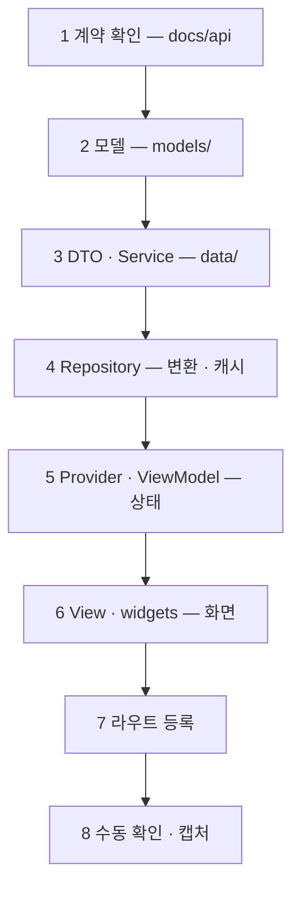

각 단계마다 "끝나는 기준"이 있다(DTO는 `fromJson` 테스트, ViewModel은 로딩·성공·실패·중복 4케이스 등). 아래층이 먼저 있어야 위층을 테스트할 수 있어서 이 순서다.

### 6-3. PR이 머지되기까지

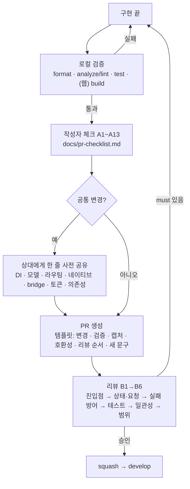

자세히: [workflow.md](./workflow.md), [pr-checklist.md](./pr-checklist.md)

## 7. "누가 만들어도 같은 느낌"은 어떻게 지키나

느낌을 검사 가능한 항목으로 바꾸고, 사람이 보던 항목을 차례로 자동화로 옮긴다.

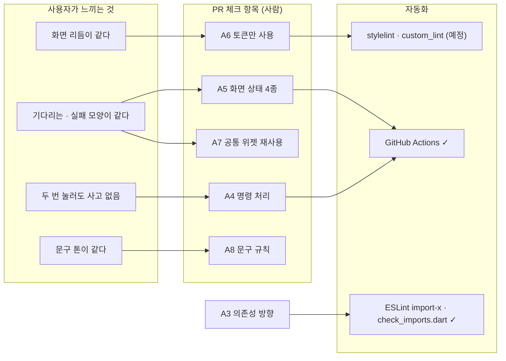

운영 규칙: 같은 지적이 PR에서 **2번** 나오면 체크 항목으로 올리고, **3번** 나오면 린트·테스트·공통 위젯으로 옮긴다. 체크리스트는 길어지지 않고 자동화만 늘어난다.

## 8. 아직 없는 것 — 다음에 할 일

| 영역 | 없는 것 | 언제 |
| --- | --- | --- |
| 앱 | `shared/widgets`(Loading·Error·Empty), `core/error`, 토큰 갱신·세션 복원 | 첫 기능(로그인) 만들 때 |
| 웹 | `shared/ui`, `shared/bridge`, 서버 데이터 라이브러리 결정, 호스팅 | 첫 API 연동 때 |
| 배포 | Shorebird, Fastlane, 스토어 서명 (CI 검사는 있음) | 첫 내부 테스트 배포 전 |
| 팀 합의 | `develop` 브랜치, 문구 톤·용어집, 공통 위젯 1차 목록, 캡처 기준 기기 | 첫 PR 전 |

## 9. 문서 지도

| 알고 싶은 것 | 문서 |
| --- | --- |
| 항상 지킬 것 (짧게) | [AGENTS.md](../AGENTS.md) |
| 일하는 순서 | [workflow.md](./workflow.md) |
| 앱 폴더·의존성·금지 | [mobile-architecture.md](./mobile-architecture.md) |
| 웹 폴더·의존성·bridge·환경 | [web-architecture.md](./web-architecture.md) |
| 색·간격·글자 크기 값 | [design-tokens.md](./design-tokens.md) |
| PR 체크 항목과 그 이유 | [pr-checklist.md](./pr-checklist.md) |
